 

  

  

  
  
  
  

  
  

---

## `~/whoami`

  

I'm **Aryan Yadav**, a second-year B.Tech student in Computer Science and Technology at JIS College of Engineering.

I enjoy turning ideas into working products, experimenting with emerging technologies and solving practical problems through code.

My interests revolve around **AI/ML, Generative AI, Full-Stack Development and AI-powered applications**. I also explore cybersecurity, hardware and IoT, and spend time strengthening my problem-solving skills through DSA.

Hackathons have been an important part of my learning journey, giving me opportunities to collaborate, experiment and build under real-world time constraints.

**My approach:** Learn deeply. Build practically. Improve continuously.

---

## `./featured-projects`

A selection of projects that reflect my interests in building practical software and exploring emerging technologies.

<table>
  <tr>
    <td width="50%" valign="top">
      <h3>🏥 MedicalAI</h3>
      <b>AI-Assisted Clinical Intelligence & Preliminary Triage</b>
        
      An AI-powered healthcare platform focused on preliminary health guidance, multilingual interactions, patient profiles, QR-based patient identification, medication reminders and emergency workflows.
        
      
      
      
      
      
        
      <a href="https://github.com/uiaryanyadav1109-dev/MedicalAI"><b>Repository →</b></a> · <a href="https://medicalai-1.onrender.com/"><b>Live Demo →</b></a>
       
      Developing project. Not a replacement for professional medical diagnosis.
    </td>
    <td width="50%" valign="top">
      <h3>🏛️ NLAMS AI Engine</h3>
      <b>AI-Powered Land Acquisition Intelligence</b>
        
      An AI engine for land acquisition workflows, covering Gazette OCR, land valuation under RFCTLARR, grievance triage, cadastral geometry verification and automated award-summary generation.
        
      
      
      
      
      
        
      <a href="https://github.com/uiaryanyadav1109-dev/NLAMS-1"><b>Repository →</b></a>
    </td>
  </tr>
  <tr>
    <td width="50%" valign="top">
      <h3>🌱 GreenOps</h3>
      <b>Infrastructure Monitoring & Green Computing</b>
        
      A monitoring system focused on collecting infrastructure telemetry, including CPU, RAM, disk and network metrics. Working on the Python monitoring agent and telemetry pipeline for structured data collection and ML-ready preprocessing.
        
      
      
      
      
      
    </td>
    <td width="50%" valign="top">
      <h3>🛡️ VoiceShield</h3>
      <b>AI-Based Voice Fraud Protection</b>
        
      A project concept exploring protection against voice-cloning fraud in banking through impersonation detection, fraud-risk analysis and AI-assisted verification workflows.
        
      
      
      
    </td>
  </tr>
  <tr>
    <td width="50%" valign="top">
      <h3>📄 Saral</h3>
      <b>AI-Powered Document Simplification</b>
        
      An application concept for making complex documents easier to understand through summarization, key-information extraction, important-date detection and actionable insights.
        
      
      
      
    </td>
    <td width="50%" valign="top">
      <h3>🛍️ FitMart</h3>
      <b>Fitness & Nutrition E-Commerce</b>
        
      A full-stack commerce platform combining fitness shopping, nutrition products and workout-oriented experiences.
        
      
      
      
      
      
      
    </td>
  </tr>
</table>

### More projects

| Project | Description | Technologies |
|:--|:--|:--|
| [QR Nova](https://qrnova.vercel.app) | Customizable QR Code Studio | HTML, CSS, JavaScript |
| VibePlayer | Personal music and video player | React, Vite |
| Personal Portfolio | Developer portfolio and project showcase | React, Vite |

  <a href="https://github.com/uiaryanyadav1109-dev?tab=repositories"><b>Explore all repositories →</b></a>

---

## `./hackathons`

I enjoy participating in hackathons because they challenge me to turn ideas into practical solutions, collaborate with different people and learn technologies outside my comfort zone.

| Event | Contribution / Focus |
|:--|:--|
| **Smart India Hackathon (SIH)** | Frontend and AI backend engineering |
| **MSME Idea Hackathon 6.0** | Full-stack engineering and innovation |
| **JISTECH 2026** | Hardware engineering |
| **CRAZY BUILDS** | Frontend and backend engineering |
| **HackNex 2.0** | AI and backend engineering |
| **AKI HACKS × HACKTOBERFEST'26** | Hackathon participant |
| **HackInverse 1.0** | Team-based AI project development |

### A milestone worth mentioning

  

**SIH Akatsuki:** Shortlisted 11th among 110+ teams, achieving a score of 92/100.

### Certifications

- Python (Basic)
- Generative AI — Basic to Advance
- RAG Masters — Euron

---

## `./tech-stack`

Technologies I use, experiment with and continue learning.

### Languages

  

### Frontend Development

  

### Backend & Databases

  

### AI / ML & Data

  
  
  

### Developer Tools

  

---

## `./currently-learning`

  
  
  
  
  
  

---

## `./github-stats`

  
  

  

  

  

<b>Contribution Snake</b>

 

  <picture>
    <source media="(prefers-color-scheme: dark)" srcset="https://raw.githubusercontent.com/uiaryanyadav1109-dev/uiaryanyadav1109-dev/output/github-contribution-grid-snake-dark.svg">
    <source media="(prefers-color-scheme: light)" srcset="https://raw.githubusercontent.com/uiaryanyadav1109-dev/uiaryanyadav1109-dev/output/github-contribution-grid-snake.svg">
    
  </picture>

---

## `./leetcode`

  

---

## `./collaborate`

I'm interested in collaborating on projects involving:

- AI/ML and Generative AI applications
- Healthcare technology and responsible AI
- EdTech and student-focused platforms
- Full-stack web applications
- Cybersecurity and AI security
- Infrastructure monitoring and Green Computing
- Hardware, IoT and intelligent systems
- Hackathons and open-source development

Always open to learning from others, exchanging ideas and building something meaningful together.

---

## `./connect`

  
  
  
  

  <b>IDEA → BUILD → TEST → LEARN → IMPROVE</b>
   
  <i>Every bug is another step in the training arc.</i>

  

